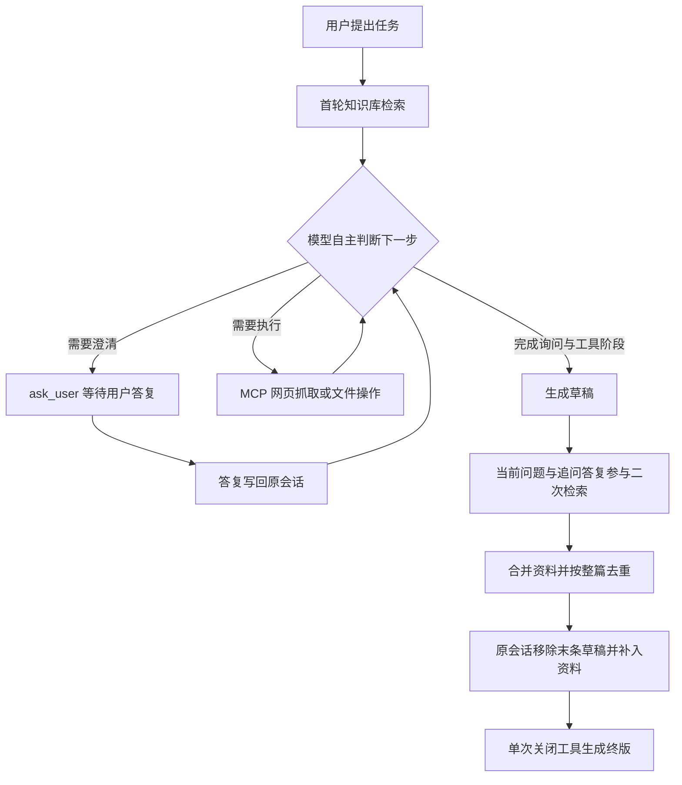

# Clarify Agent

**通过自主追问挖掘用户需求的 RAG 决策规划系统。**

面向用户难以一次想全、说全需求的规划任务，让 Agent 主动识别信息缺口、确认关键条件，再围绕真实需求检索资料、形成方案。以旅游规划为首个验证场景，支持网页与终端交互。

[项目介绍](#项目介绍) · [快速开始](#快速开始) · [评估设计与结果](#评估设计与结果) · [Excel 评估看板](result/攻略Agent评估成绩单.xlsx) · [开发与部署](#开发与部署)

## 项目介绍

### 从什么问题出发

规划类任务的困难，往往出现在生成答案之前。用户说“帮我制定一份旅游攻略”时，可能已经知道目的地，却还没有想全同行人的体力、预算上限、出行节奏和取舍偏好。这些信息没有被表达出来，方案就容易建立在默认假设上；即使内容丰富，用户仍需阅读后补充条件、要求重做。

旅游社区提供了大量经验，但筛选、判断与重新组合的工作仍留给用户；仅根据首问生成，也难以照顾尚未被说出的约束。Clarify Agent 因此把任务拆为两个需要分别解决的问题：**先挖掘用户真正需要什么，再找到支撑方案的事实与经验。**

### 产品定位与交互分工

Clarify Agent 是一个面向建议、策略与规划任务的交互式 Agent，以旅游作为首个验证场景。系统结合自主追问、会话记忆、RAG 与 MCP 工具，帮助用户逐步明确目标和限制，形成有针对性、有参考依据的方案。

交互分工是“**Agent 负责问什么，用户负责答什么**”：模型根据当前信息判断是否追问，用户补充自身条件并做关键选择；答复回到同一条任务链，模型再决定检索、执行工具或生成方案。资料中的他人经历可以提供事实和候选路线，但不代表当前用户已经确认的需求。

### 两大产品优势

**① 主动挖掘需求，降低用户独立梳理需求的负担。**

用户不必先掌握提示词技巧，也不必一次交代所有条件。Agent 根据任务、历史和工具结果识别会影响决策的缺口，必要时停下来询问；已明确的信息、常规细节和用户允许采用的默认条件则直接推进。目标是通过必要的交互减少错误假设，避免生成一份不合适的完整方案后再返工。

**② 将能力、知识和评估分开，为规划场景复用保留空间。**

- **能力层**：自主追问、多轮记忆、工具调度和终版生成。
- **知识层**：以目录组织的领域资料、向量检索和方案参考依据。
- **评估层**：隐藏需求、方案要点、三层指标与 A/B/B2 对照方法。

旅游是这套结构的首个应用，而非能力层的固定边界。考研规划、职业发展等方向可以复用交互与工具调度，再适配领域资料、必要规则和评估题目。这里强调的是架构复用：新场景的知识质量、工具适配和实际效果仍需重新验证，不能仅凭更换文档就保证同样收益。

### 从 MVP 到可验证的产品迭代

1. **V1：打通最小闭环。** 以手写 Agent 接入 RAG 与 MCP，验证检索、工具执行和方案生成的基础链路。
2. **V2：加入自主追问。** 将信息缺口识别、询问、答复回写纳入任务过程，并通过提示词区分外部资料与用户需求。
3. **V3：让澄清信息回流检索。** 用 B2 在终版前补充检索，合并资料，沿原会话排除末条草稿，再生成终版。

每次迭代都对应一个可检验的问题：追问是否改善需求匹配，澄清后的资料补充与终版处理是否进一步改善方案质量。项目用固定题库、模拟用户、模型裁判和代码核算记录结果，再将 B2 接回 Web/CLI 默认流程，形成“问题发现—机制设计—对照评估—产品接入”的迭代闭环。

## 核心机制

### 1. 自主追问，挖掘用户需求

将“问什么、何时问”的判断交给模型。Agent 通过 `ask_user` 等待真实用户答复，将答复写回原会话，再决定继续询问、执行工具或生成方案。

- 区分“资料充分”和“需求明确”，不把攻略中的天数、预算和偏好当作用户条件。
- 只询问影响下一步决策的关键缺口；已明确的信息不重复确认。
- 问题随任务和工具结果生成，无固定问卷；信息充分或用户允许采用默认条件时，可以直接推进。

### 2. 澄清后二次检索，补充方案依据

用户补充需求后，首问检索得到的资料未必仍然匹配。B2 在生成终版前，用当前问题和可还原的追问答复重新检索，合并两轮资料并按整篇去重。

终版沿用原会话，保留用户条件与工具结果，仅移除末条完整草稿，再追加资料和输出要求。本次终版请求关闭工具，后续新任务仍可正常使用工具。

**当前网页与终端入口均已启用 B2。** 系统仍先生成草稿，再检索并生成终版；它不是每收到一次用户答复就立即重新检索。

<details>
<summary>交互示意：从宽泛需求到有约束的方案</summary>

以下仅为交互示意，具体询问内容由模型自主决定。

> **用户**：帮我安排杭州周末游。  
> **Agent → ask_user**：和谁一起出行？有没有需要控制步行强度的情况？  
> **用户**：带父母，两天预算2500元，他们膝盖不太好。

Agent 将答复作为工具结果写入会话，继续判断是否还需确认其他关键条件；完成询问和工具阶段后，利用补充需求再次检索资料，生成贴合已确认条件的终版方案。

</details>

## 运行机制

采用手写 Agent 循环，将模型、用户交互、MCP 工具和知识检索连接起来。



- **会话记忆**：多轮问题、回答和工具结果保存在同一组消息中；本轮任务异常失败时撤回本轮新增消息。
- **工具调度**：同批包含 `ask_user` 和其他工具时，其他操作暂缓，收到答复后由模型重新决策。
- **知识检索**：每场会话构建一次文档向量库，后续复用；每个新问题重新检索，B2 在终版前再检索一次。
- **网页反馈**：流式文字、工具进度、中途询问与取消操作，共用与 CLI 相同的 Agent 核心。

消息回滚和取消不会撤销已经完成的文件操作。MCP 网页工具提供网页抓取能力，具体可执行操作以已注册工具为准。

## 快速开始

### 1. 安装环境与依赖

需要 **Python 3.11+、uv、Node.js/npm**。前端为静态 HTML/CSS/JavaScript；Node.js 用于运行文件操作 MCP 服务。

首次克隆，在 Windows PowerShell 中执行：

```powershell
git clone https://github.com/tangjia-peng/clarify-agent.git
cd clarify-agent
uv sync --cache-dir .uv-cache
Copy-Item .env.example .env
```

已有本地项目时，直接进入项目目录安装依赖即可，保留已有 `.env`。macOS/Linux 可用 `cp .env.example .env` 创建首次配置。

### 2. 配置模型与向量接口

参考 [.env.example](.env.example)，在自己的 `.env` 中填写：

- `OPENAI_API_KEY`、`OPENAI_BASE_URL`、`OPENAI_MODEL`：主 Agent 模型，需支持 OpenAI 兼容的流式工具调用。
- `EMBEDDING_KEY`、`EMBEDDING_BASE_URL`、`EMBEDDING_MODEL`：向量服务；基础地址不加末尾 `/embeddings`，程序会自动补上。

模板保留了模型名称与公开服务地址，密钥为空。模型和向量请求会使用你配置的 API 额度；首次提问会为当前会话的知识文档生成向量，MCP 服务首次运行也可能下载依赖。

`JUDGE_*`、`SIM_USER_*` 仅用于评测，启动网页或 CLI 时无需填写。模板中的 Qwen 地址是占位地址，**跑评测前必须替换，并填写与该服务匹配的模型和密钥**。

### 3. 启动网页或终端

网页端：

```powershell
uv run --cache-dir .uv-cache web_main.py
```

浏览器打开 [http://127.0.0.1:8765](http://127.0.0.1:8765)，保持终端运行。页面出现询问时，在答复区域补充信息，继续当前任务。页面打开本身不会请求模型，发送任务后才开始初始化与调用。

终端端：

```powershell
uv run --cache-dir .uv-cache main.py
```

`你：` 接收新问题；`Agent 询问：` 表示任务中途需要答复。询问时输入 `/cancel` 取消当前任务，输入 `/exit` 结束会话。

命令速查：

```powershell
python command.py show
```

## 评估设计与结果

### 三种模式，逐步验证迭代收益

构建覆盖信息完整、部分、模糊、不合理与应拒绝请求的 **5类、20题评估集**，逐题预置首问、隐藏需求和方案要点。围绕需求匹配、事实可靠性、交互成本建立指标。

- **A｜直接生成**：使用首轮 RAG，不注册询问工具。
- **B｜自主追问**：使用首轮 RAG，通过追问确认需求后生成方案。
- **B2｜二次检索与终版优化**：直接复用 B 的完整会话和同一问答轨迹，补充检索并生成终版。

**A/B 比较自主追问的整体收益；B/B2 在相同交互条件下比较终版处理的组合收益。** B2 同时改变资料补充、草稿处理和输出指令，不能将所有改善单独归因于二次检索。

### 跑题—模型裁判—代码核算—Excel 看板

1. **模拟用户披露需求**：Agent 只看到首问，Qwen3.5-Flash 根据隐藏需求逐轮作答；设定外问题在既定约束内合理回答。设置15轮模拟应答预算及超限收口机制，减少人工逐轮应答投入。
2. **逐题约束裁判**：Qwen-Plus 综合完整需求、追问对话、最终方案和检索资料评分。按每个 case 预填评分明细框架，由模型逐项判定并给出依据，减少漏评与口径漂移。
3. **明细驱动核算**：代码以逐项明细重算汇总指标，录入阶段继续核对一致性，保留依据供复核；这能约束计数偏差，语义判断仍需核查。
4. **复用交互控制变量**：B2 省去重复模拟用户和重新追问的过程，固定询问路径与用户信息，提高 B/B2 的可比性。

15轮预算限制的是模拟用户作答，不等同于整个 Agent 的执行上限。模拟用户与裁判模型均可通过环境变量配置。

### 内部离线对照结果

以下为项目报告引用的 **2026-11-19 成绩单**，对应20题内部对照：

- **需求满足率**：A **36.4%** → B **76.1%** → B2 **77.5%**。
- **要点覆盖率**：A **37.5%** → B **66.3%** → B2 **74.0%**。
- **硬信息准确率**：B **50.5%** → B2 **77.0%**。
- **无依据陈述率**：B **27.2%** → B2 **17.8%**。

这批结果支持“先挖掘需求，再增强事实支撑”的迭代顺序。它属于小样本固定题库与模型裁判评测，不是线上真实用户 A/B；事实指标按评估资料核验，不等同于现实信息已经核实最新有效，也不代表已证明降低响应时间或接口费用。

详见 [项目报告](<result/Clarify Agent-项目报告（简历面试版）.md>)、[指标与评估集说明](result/Agent评估指标体系与评估集模板.md) 和 [产品迭代记录](产品迭代优化.md)。

### 复现评测

先在 `.env` 中配置 `JUDGE_*` 和 `SIM_USER_*`，每组地址、模型和密钥需匹配。若统一使用主模型，将该组的三项一起留空或注释；各字段只会分别回退到对应的 `OPENAI_*`，不会复用另一组 Qwen 密钥。

从单题开始：

```powershell
# 跑题：会请求模型、向量接口和工具
uv run --cache-dir .uv-cache python eval/run_ab.py --tasks T01 --modes A,B,B2

# 只生成裁判提示词，不请求裁判模型
uv run --cache-dir .uv-cache python eval/judge.py --tasks T01 --dry

# 正式裁判：会请求裁判模型
uv run --cache-dir .uv-cache python eval/judge.py --tasks T01
```

全量运行跑题与裁判、跳过 Excel 录入：

```powershell
python command.py eval --skip-record
```

默认产出位于当前项目的 `result/`；`EVAL_HOME` 可覆盖。可选 `EVAL_SEED` 必须是整数，不要设置为空值。

### Excel 结果看板与录入

仓库附有 [攻略 Agent 评估成绩单](result/攻略Agent评估成绩单.xlsx)，保留现有结果、公式和核查明细，可下载后使用 Excel 或 WPS 查看：

- **A-B对比**：三种模式的汇总指标与变化。
- **成绩单**：各题、各模式的评分数据。
- **瞎编核查、硬信息核查、白问核查**：判定依据、核查记录与人工复核字段。
- **瞎编核查B2、硬信息核查B2**：B2 的独立核查明细。
- **填写说明**：工作簿的填写规则。

该文件是已填写的评测结果快照。重跑并录入会更新相应题目，未重跑的题目仍可能保留历史结果；开始新批次前建议另存一份，避免混淆批次。代码核算约束计数与一致性，不替代对明细判定的人工复核。

先生成裁判输出，再在项目根目录执行下面的命令，将结果写入成绩单；`--with openpyxl` 为本次运行提供录入依赖：

```powershell
uv run --cache-dir .uv-cache --with openpyxl python result/自动录入.py
```

录入前关闭正在使用该文件的 Excel/WPS 窗口。公开仓库仍不包含完整对话、messages 快照和裁判原文；它们可由配置接口后重新跑题、裁判生成。更多操作见 [评测使用说明](eval/使用说明.md) 和 [评估目录说明](result/README.md)。

## 知识库与当前边界

[knowledge](knowledge) 包含 **50座城市、每城3篇，共150篇旅游笔记文字正文**，保留来源与作者归因。每篇采用简短来源信息、一份正文和覆盖范围说明；源记录支持正文与 SHA-256 一致性核验。公开副本移除了链接中的访问签名，媒体和采集环境细节保留在本地。

查看 [知识目录](data/travel_collection/COLLECTION_INDEX.md) 和 [采集说明](data/travel_collection/README.md)。当前边界包括：

- 图片文字、视频和评论未转录；攻略中的价格、营业时间等未自动核验实时有效性。
- 每篇文档整体向量化，默认余弦相似度 top3；尚无分块、相关度阈值或重排。
- 记忆与向量库保存在会话内存中，网页刷新、重连或进程重启后不保留原会话；长历史尚无摘要裁剪。
- 二次检索从会话历史提取追问问答，尚未严格按任务切分；普通聊天中的所有条件也未统一结构化为检索需求。
- B2 仍先生成草稿，通常新增一次问题向量化和一次终版生成；草稿可能已流式展示。
- 目前为小规模原型。跨领域迁移、长期记忆及稳定并发能力需要进一步设计与验证。

## 开发与部署

### 离线机制验证

最近公开版本已通过 **85项离线自动测试**，覆盖会话记忆、询问答复、混合工具批次暂缓、B2 历史继承、异常恢复、资料去重和网页访问隔离。

```powershell
uv run --cache-dir .uv-cache python -m unittest discover -s tests -v
uv run --cache-dir .uv-cache python data/travel_collection/validate_collection.py
```

测试使用模拟模型、向量接口和本地 MCP 测试服务，不调用真实模型 API。知识校验检查150篇文档与源记录的一致性；它与真实模型效果评测承担不同职责。

### 项目结构

```text
src/                         Agent、模型通信、RAG、MCP、网页后端
web/                         页面、交互脚本、样式与插画
knowledge/                   正式参与检索的知识文档
data/travel_collection/      采集维护、源记录与正文校验
eval/                        三模式跑题与模型裁判
tests/                       离线自动测试
result/                      评估集、录入脚本、指标与项目报告
main.py / web_main.py        CLI / Web 启动入口
command.py                   命令速查与执行入口
.env.example                 不含真实凭据的配置模板
```

核心实现见 [Agent 调度](src/agent.py)、[模型与消息历史](src/chat_openai.py)、[MCP 客户端](src/mcp_client.py)、[检索资料合并](src/context_documents.py)。

### 公网运行

默认只监听本机 `127.0.0.1:8765`。仓库提供 Docker、Compose 和 Render 部署配置，公网模式支持访问口令、来源校验及独立文件工作目录；具体步骤见 [部署说明](DEPLOYMENT.md)。

公网访客使用的是服务器上的 Agent 与文件工作目录。当前采用单进程内存会话和共享访问口令，适合小范围演示；公开代码仓库地址不等同于已部署的在线体验地址。

## 来源

基础 Agent / MCP / RAG 模块参考 [KelvinQiu802/llm-mcp-rag](https://github.com/KelvinQiu802/llm-mcp-rag)，在 Python 实现上持续迭代多轮会话、自主追问、澄清后二次检索、网页交互及评估链路。知识文档保留各自来源与作者归因。
